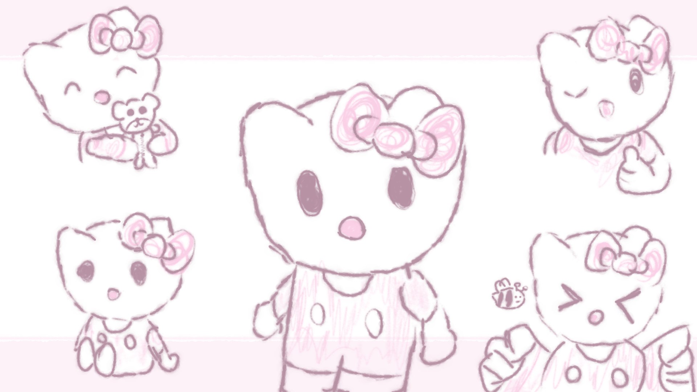

# dwm + st + dmenu — hellokitty rice

A minimal Arch Linux X11 desktop built from suckless sources: **dwm 6.8**,
**st 0.9.3** and **dmenu 5.4**, recolored from the pink palette of
[`wallpapers/hellokitties.png`](wallpapers/hellokitties.png).



## What's inside

| Path | Goes to | What it is |
|---|---|---|
| `.config/dwm/` | `~/.config/dwm/` | autostart + status-bar clock |
| `.config/superfile/` | `~/.config/superfile/` | superfile config + `hellokitties` theme |
| `.config/udiskie/` | `~/.config/udiskie/` | lets the internal `Files` volume through |
| `suckless/dwm/` | build & install | dwm with **systray** patch + autostart hook |
| `suckless/st/` | build & install | terminal, same palette |
| `suckless/dmenu/` | build & install | launcher UI, same palette |
| `system/polkit-1/rules.d/61-udisks2.rules` | `/etc/...` | passwordless udisks2 for `wheel` |
| `wallpapers/hellokitties.png` | `~/hellokitties.png` | desktop background |
| `.xinitrc`, `.Xresources` | `~/` | `exec dwm`, cursor/font settings |

## Palette

| Role | Color |
|---|---|
| background | `#FDF2F8` |
| foreground | `#4A2330` |
| accent / selection / cursor | `#B894A6` |
| borders | `#E3C9D2` |

## Install

```sh
git clone https://github.com/Sobserius/dotfiles.git
cd dotfiles
./install.sh
```

`install.sh` copies the configs and wallpaper into `$HOME`, builds/installs the
three suckless tools (via `sudo make install`), and installs the polkit rule.

### Dependencies (Arch)

```sh
sudo pacman -S --needed base-devel libx11 libxft libxinerama freetype2 \
  fontconfig noto-fonts j4-dmenu-desktop udiskie polkit feh scrot superfile \
  pipewire pipewire-pulse wireplumber pavucontrol
```

Start it with `startx` (`.xinitrc` execs dwm). It is designed to live on a
secondary VT, e.g. `startx -- :0 vt2`.

## Keybinds

| Keys | Action |
|---|---|
| `Super + d` / `Super + p` | app launcher (`j4-dmenu-desktop` → `dmenu`) |
| `Super + Return` | new terminal (`st`) |
| `Super + q` / `Super + c` | kill focused window |
| `Super + Shift + q` | quit dwm |
| `Print` | full-screen screenshot → `~/Pictures/Screenshots/` |
| `Alt + Print` | select-region screenshot → `~/Pictures/Screenshots/` |
| `Super + j` / `k` | focus next / previous window |
| `Super + h` / `l` | shrink / grow master area |
| `Super + t` / `f` / `m` / `Space` | tile / float / monocle / cycle |
| `Super + 1…9` | switch tag |
| `Super + Shift + 1…9` | move window to tag |
| `Super + Tab` | previous tag |
| `Super + b` | toggle the bar |

Keyboard layouts are `us,ru`, switched with **Alt+Shift** (no LED options set).

## Notes

- **No terminal at startup** — the desktop comes up clean; `Super + Return` opens st.
- **Window gaps** — `resizehints = 0` in dwm so tiled windows actually fill the
  work area instead of snapping to terminal cell sizes.
- **Systray** — the dwm systray patch is applied; it exists for the udiskie icon
  (and anything else that docks). Set `showsystray = 0` in `config.h` to drop it.
- **Passwordless mounts** — `61-udisks2.rules` returns `polkit.Result.YES` for
  `org.freedesktop.udisks2.*` to members of `wheel`. Change the group name if
  your distro uses a different admin group.
- **PipeWire** — `pipewire`, `pipewire-pulse` and `wireplumber` must be enabled
  for the user:
  ```sh
  systemctl --user enable --now pipewire pipewire-pulse wireplumber
  ```
  If your session has no logind ACL on `/dev/snd` (e.g. X started from a
  detached process), also `sudo gpasswd -a "$USER" audio`.
- **Wallpaper is optional** — autostart silently skips it if
  `~/hellokitties.png` is missing.
- The vendored suckless programs keep their upstream MIT licenses.

## superfile theme

`~/.config/superfile/theme/hellokitties.toml` mirrors the desktop palette; enable
it in `~/.config/superfile/config.toml`:

```toml
theme = "hellokitties"
```
